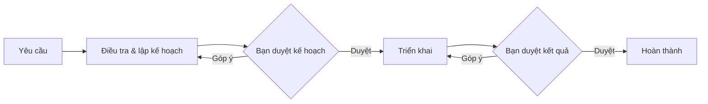

# TaskPilot

Chạy quy trình lập kế hoạch và triển khai bằng Claude Code, GitHub Copilot CLI hoặc Codex CLI ngay trong repo, với các bước chờ bạn duyệt.

TaskPilot đọc yêu cầu từ `.claude/tasks/<key>/spec/`, gửi prompt vào phiên CLI tương tác và hiển thị tài liệu, tiến độ, terminal trong trình duyệt. Bạn có thể nhập trực tiếp vào terminal; cấu hình và quyền của CLI vẫn được áp dụng.

Khu vực Cấu hình có bộ chọn Claude, Copilot, Codex và API cho file native của từng CLI. Biểu mẫu web hiện chỉ mở cho Claude; với Copilot/Codex, bộ chọn hiển thị phạm vi hỗ trợ trong khi route giao diện native chưa được tích hợp. Xem [ma trận cấu hình](docs/CONFIGURATION.md#cấu-hình-cli-và-mcp). Bộ chọn này không đổi agent/model hoặc quyền của workflow.

Chọn workflow, agent và model độc lập cho mỗi lần chạy, hoặc lưu agent/model làm mặc định repo. Khi đang làm dở, **Tiếp tục bằng…** bàn giao đúng bước hoặc việc con sang phiên mới, giữ tài liệu và lịch sử. Xem [chọn agent và bàn giao](docs/GUIDE.md#chọn-agent-và-model).



## Yêu cầu

- Node.js 22+; đã thử trên Node.js 24.
- Bộ công cụ biên dịch cho `node-pty`: `g++`, `make`, `python3`.
- CLI của agent được chọn đã cài và đăng nhập; Claude/Copilot dùng `curl` để gửi hooks.
- Codex CLI (`codex`) đã đăng nhập qua `codex login` nếu dùng agent **Codex**. Đã kiểm với `codex-cli 0.163.0`; phiên Codex dùng hội thoại và nút duyệt quyền trên web.
- Khi chọn **Theo cấu hình workflow**, `default` dùng Claude điều tra và Copilot triển khai, còn `leader` dùng Claude làm leader. Chọn agent cụ thể, chẳng hạn **Codex**, để dùng agent đó cho cả quy trình mà không tạo override YAML; xem [thứ tự ưu tiên](docs/CONFIGURATION.md#lựa-chọn-execution-và-mặc-định-repo).

## Cài và chạy

Chạy trong thư mục mã nguồn TaskPilot:

```bash
npm ci
npm run build
npm start -- --repo /duong/dan/repo --open
```

Mở URL server in ra, có dạng `http://127.0.0.1:8790/?token=…`. Nếu đã cấu hình tài khoản, trình duyệt sẽ hiện màn hình đăng nhập.

Để dùng lệnh `taskpilot` ở mọi thư mục, chạy `npm link` trong thư mục TaskPilot, rồi:

```bash
taskpilot --repo /duong/dan/repo --open
```

| Tùy chọn        | Ý nghĩa                                                                                                 |
| --------------- | ------------------------------------------------------------------------------------------------------- |
| `--repo <path>` | Repo cần mở; mặc định dùng thư mục hiện tại nếu có `.claude/tasks`, nếu không thì dùng repo mở gần nhất |
| `--host <addr>` | Địa chỉ lắng nghe; mặc định `127.0.0.1`                                                                 |
| `--port <n>`    | Cổng; mặc định `8790`                                                                                   |
| `--open`        | Mở trình duyệt                                                                                          |

## Tài liệu

- [Sử dụng](docs/GUIDE.md): chọn agent/model, duyệt, bàn giao và tiếp tục khi gián đoạn.
- [Cấu hình](docs/CONFIGURATION.md): biến môi trường, ma trận file của ba CLI và workflow tùy chỉnh.
- [Triển khai](docs/DEPLOY.md): systemd, reverse proxy và xác thực.
- [Phát triển](docs/DEVELOP.md): môi trường dev, kiểm thử và quy tắc mã nguồn.
- [Kiến trúc](docs/SPEC.md): cơ chế phiên CLI, workflow engine và lưu ý tương thích.
