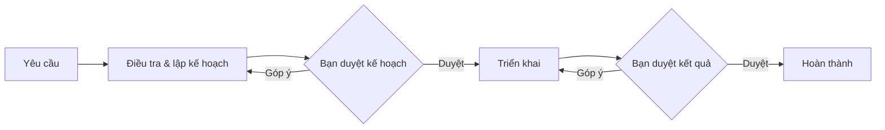

# TaskPilot

Chạy quy trình lập kế hoạch và triển khai bằng Claude Code, GitHub Copilot CLI hoặc Codex CLI ngay trong repo, với các bước chờ bạn duyệt.

TaskPilot đọc yêu cầu từ `.claude/tasks/<key>/spec/`, gửi prompt vào phiên CLI tương tác và hiển thị tài liệu, tiến độ, terminal trong trình duyệt. Bạn có thể nhập trực tiếp vào terminal; cấu hình và quyền của CLI vẫn được áp dụng.



## Tính năng

- **Workflow theo cách chạy.** `Solo`: một agent điều tra, lập kế hoạch rồi triển khai; ba duyệt sau mỗi bước. `Leader`: leader lập kế hoạch và giao việc, mỗi việc con chạy trong session riêng, rồi leader rà soát. Repo đổi workflow bằng override trong `.taskpilot/` (trang Workflow).
- **Chọn agent và model** cho mỗi lần chạy, hoặc lưu làm mặc định repo. Khi đang làm dở, **Tiếp tục bằng…** bàn giao đúng bước hoặc việc con sang session mới, giữ tài liệu và lịch sử.
- **Cấu hình agent** (Claude, Copilot, Codex): mỗi mục có hai cách xem. **Giao diện** chỉ để xem; **Raw** sửa thẳng file của CLI, xem diff trước khi lưu, kiểm cú pháp và sao lưu file cũ (trang Lịch sử thay đổi để khôi phục).
- **Tổng quan**: việc đang chờ bạn, run đang chạy, hạn mức tài khoản của từng agent.
- **Worktree riêng cho mỗi run** (tuỳ chọn khi bắt đầu hoặc chạy lại): run có branch `taskpilot/<task>-<id>` và thư mục riêng; repo chỉ đổi khi bạn bấm **Tích hợp**. Xem mục [Run trong worktree](#run-trong-worktree).

## Yêu cầu

- Node.js 22+; đã thử trên Node.js 24.
- Bộ công cụ biên dịch cho `node-pty`: `g++`, `make`, `python3`.
- CLI của agent được chọn đã cài và đăng nhập; Claude/Copilot dùng `curl` để gửi hooks.
- Codex CLI (`codex`) đã đăng nhập qua `codex login` nếu dùng agent Codex.

TaskPilot theo bản Codex mới nhất đang cài; lần kiểm TPL-039 dùng `codex-cli 0.165.0`, không đặt mốc tối thiểu `0.163.0`. Hooks của TaskPilot được truyền qua `-c` mỗi lần chạy; lần đầu Codex yêu cầu duyệt trong terminal (`/hooks`), TaskPilot không tự tin cậy hook hoặc thay quyền workflow. Agent con, compact và session end của Codex chưa được theo dõi; TaskPilot không suy agent con từ template workflow.

Token Codex là tổng tích lũy của root thread từ rollout, không phải phần dùng riêng của từng lượt/bước và không phải hạn mức tài khoản. Số đo được thay snapshot, không cộng lại khi Stop/resume lặp; cùng native thread chỉ tính một lần trong tổng. Thiếu file, không đọc được hoặc không xác minh đúng thread được ghi rõ; số đo cũ được giữ với nhãn **số liệu lần trước**, không biến thành 0. Chi phí Codex không hỗ trợ; cache/reasoning tokens và effort thực tế chưa có nguồn runtime được xác minh. Nếu rollout không cung cấp metadata root CLI đúng phiên, TaskPilot giữ trạng thái chưa quan sát được thay vì gán callback cho một phiên khác.


## Cài và chạy

Trong thư mục mã nguồn TaskPilot:

```bash
npm ci
npm run build
npm start -- --repo /duong/dan/repo --open
```

Mở URL server in ra, có dạng `http://127.0.0.1:8790/?token=…`. Nếu đã cấu hình tài khoản, trình duyệt hiện màn hình đăng nhập.

Để dùng lệnh `taskpilot` ở mọi thư mục, chạy `npm link` trong thư mục TaskPilot, rồi:

```bash
taskpilot --repo /duong/dan/repo --open
```

| Tùy chọn        | Ý nghĩa                                                                                                 |
| --------------- | ------------------------------------------------------------------------------------------------------- |
| `--repo <path>` | Repo cần mở; mặc định dùng thư mục hiện tại nếu có `.claude/tasks`, nếu không thì dùng repo mở gần nhất |
| `--host <addr>` | Địa chỉ lắng nghe; mặc định `127.0.0.1`                                                                 |
| `--port <n>`    | Cổng; mặc định `8790`                                                                                   |
| `--open`        | Mở trình duyệt                                                                                          |

Biến môi trường (địa chỉ, cổng, đăng nhập, token) đọc từ `.env` cạnh `package.json`; xem `.env.example`.

## Run trong worktree

Bật **Chạy trong Git worktree riêng** khi bắt đầu một run để hai task chạy song song không sửa đè nhau. Mọi session của run (leader, member, session sau bàn giao) chạy trong cùng worktree đó; các member của một run vẫn dùng chung worktree và quy tắc tránh trùng file như cũ. Đây không phải sandbox bảo mật.

- **Vị trí:** `<TASKPILOT_HOME>/worktrees/<hash repo>/<task>-<id>` (mặc định `~/.taskpilot/worktrees/…`), ngoài repo. Base là `HEAD` của repo lúc bắt đầu.
- **Thay đổi chưa commit của repo** không được mang theo. TaskPilot liệt kê chúng và chỉ chạy khi bạn xác nhận chạy trên `HEAD`; không stash, reset hay commit hộ.
- **Tài liệu task** (`.claude/tasks/<task>`) vẫn ở repo gốc. Prompt dùng đường dẫn tuyệt đối, và CLI được cho phép thư mục đó bằng `--add-dir`.
- **File local bị ignore** (`.env`, `node_modules`, `.claude/settings.local.json`, `.codex/agents`…) không có trong worktree. Agent hoặc bạn tự cài dependency (vd `npm install`) trong worktree. Subagent chỉ nằm trong file bị ignore sẽ bị preflight chặn.
- **Tích hợp:** panel **Worktree của run** trên trang task cho xem thay đổi/diff rồi `git merge --no-ff` branch của run vào branch đang checkout. Còn file chưa commit trong worktree thì TaskPilot hỏi trước khi commit; repo gốc có thay đổi chưa commit thì từ chối. Merge lỗi được huỷ (`merge --abort`), worktree và branch giữ nguyên. Run trong worktree chạy xong chưa đánh dấu task hoàn thành; task chỉ thành hoàn thành sau khi tích hợp thành công (hoặc khi bạn tự đánh dấu).
- **Dọn:** chỉ khi run không còn chạy và mọi session trong worktree đã dừng. Worktree còn thay đổi chưa commit cần xác nhận xoá; branch chưa được merge được giữ lại.

## Chạy như service

TaskPilot chạy được như systemd user service, dùng `node` và `claude` (và `copilot` nếu có) trên `PATH` hiện tại:

```bash
cp .env.example .env   # rồi điền, chmod 600
make service-install   # build, ghi ~/.config/systemd/user/taskpilot.service, bật và khởi động lại
make service-restart   # sau khi pull code mới; các session dừng, tiếp tục từ giao diện
make service-logs
```

## Phát triển

Monorepo npm workspaces:

| Thư mục           | Package             | Nội dung                                                                   |
| ----------------- | ------------------- | -------------------------------------------------------------------------- |
| `apps/server`     | `@taskpilot/server` | Fastify server, workflow engine, session CLI; `workflows/` và `subagents/` |
| `apps/web`        | `@taskpilot/web`    | React (Vite, TanStack Router/Query, Tailwind); xem `DESIGN.md`             |
| `packages/shared` | `@taskpilot/shared` | Mã thuần dùng chung (provider id, nhãn)                                    |
| `e2e`             | (riêng)             | Playwright, chạy app cô lập                                                |

Web chỉ import type của API từ `@taskpilot/server/api-types`; mỗi module server giữ type API trong `types.ts` của nó.

```bash
make dev             # server :8791 (tsx watch) + Vite
npm run typecheck    # build shared, typecheck server (kèm emit type API) và web
npm run lint
npm run format
npm run e2e
```

Sửa `packages/shared` thì chạy `npm run build -w @taskpilot/shared`, vì server và web đọc `dist/` của nó.
