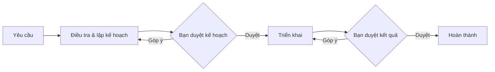

# TaskPilot

Chạy quy trình lập kế hoạch và triển khai bằng Claude Code hoặc GitHub Copilot CLI ngay trong repo, với các bước chờ bạn duyệt.

TaskPilot đọc yêu cầu từ `.claude/tasks/<key>/spec/`, gửi prompt vào phiên CLI tương tác và hiển thị tài liệu, tiến độ, terminal trong trình duyệt. Bạn có thể nhập trực tiếp vào terminal; cấu hình và quyền của CLI vẫn được áp dụng.



## Yêu cầu

- Node.js 22+; đã thử trên Node.js 24.
- Bộ công cụ biên dịch cho `node-pty`: `g++`, `make`, `python3`.
- Claude Code (`claude`) và `curl` có trong `PATH`; Claude đã đăng nhập.
- GitHub Copilot CLI (`copilot`) đã đăng nhập nếu dùng **workflow mặc định**, vì bước triển khai chạy bằng Copilot. Nếu chỉ dùng Claude, xem [cấu hình agent](docs/CONFIGURATION.md#agent-và-model).

## Cài và chạy

Chạy trong thư mục mã nguồn TaskPilot:

```bash
npm ci
npm run build
npm start -- --repo /duong/dan/repo --open
```

Mở URL server in ra, có dạng `http://127.0.0.1:8790/?token=…`. Nếu đã cấu hình tài khoản, trình duyệt sẽ hiện màn hình đăng nhập.

Để dùng lệnh `taskpilot` ở mọi thư mục, chạy `npm link` trong thư mục TaskPilot, rồi:

```bash
taskpilot --repo /duong/dan/repo --open
```

| Tùy chọn | Ý nghĩa |
|---|---|
| `--repo <path>` | Repo cần mở; mặc định dùng thư mục hiện tại nếu có `.claude/tasks`, nếu không thì dùng repo mở gần nhất |
| `--host <addr>` | Địa chỉ lắng nghe; mặc định `127.0.0.1` |
| `--port <n>` | Cổng; mặc định `8790` |
| `--open` | Mở trình duyệt |

## Tài liệu

- [Sử dụng](docs/GUIDE.md): tạo task đầu tiên, duyệt, góp ý và tiếp tục khi gián đoạn.
- [Cấu hình](docs/CONFIGURATION.md): biến môi trường, Claude, agent và workflow tùy chỉnh.
- [Triển khai](docs/DEPLOY.md): systemd, reverse proxy và xác thực.
- [Phát triển](docs/DEVELOP.md): môi trường dev, kiểm thử và quy tắc mã nguồn.
- [Kiến trúc](docs/SPEC.md): cơ chế phiên CLI, workflow engine và lưu ý tương thích.
